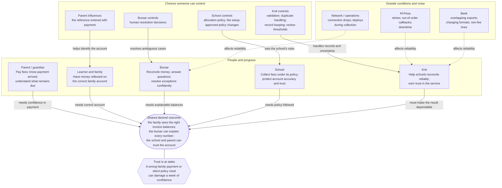

# Problem-solving notes: Knit assessment

## Bob Moesta's Four Forces

Use the Four Forces to understand why a school might adopt a payment system, hesitate, or stay with its current process. The forces describe the customer's decision to change; they are not a taxonomy of software bugs.

- **Push of the current situation:** Misapplied payments, unclear balances, and manual reconciliation create pain for school staff and parents. A silent fee-configuration change can destroy trust.
- **Pull of the new solution:** Knit promises automated payment matching, explainable invoice balances, and reliable handling of policy changes.
- **Anxiety about the new solution:** Staff may fear that automation will assign a payment to the wrong learner or silently replace school settings. One mistake can cost a week of trust.
- **Habit of the present:** Schools already reconcile M-Pesa callbacks and bank statements with familiar manual routines. Even when those routines are slow, staff may trust what they can inspect.

The wrong-child payment is a **targeting failure**: the system attributes money to the wrong learner or family. A silent configuration reset is a **trust and control failure**: a school's policy changes without a visible, accountable decision. Both raise anxiety about adopting the system and can outweigh the pull of automation.

Design implication: preserve payment evidence, explain each match and allocation, send uncertain payments to a bursar, and make policy changes versioned and reviewable. These choices make automation easier to trust.

## Empathetic perspectives in the scenario

The main decision-making perspectives are the parent, the school/bursar, and Knit. Payment providers shape the constraints. Learners and families are the people whose accounts are affected by the outcome.

- **Parent or guardian:** “Did my payment reach my family’s account? Can I understand what we still owe?” A wrong allocation or an unexplained balance can make the parent feel ignored or wrongly charged.
- **School and bursar:** “Can I trust the balances, apply our allocation policy, and explain every number?” The bursar needs a clear trail and a safe way to resolve uncertain payments. The school needs its configuration and history protected.
- **Knit:** “Can we process delayed, duplicated, or ambiguous records without losing money or trust?” Knit must make the system’s decisions visible, preserve evidence, and let a human handle cases the system cannot confidently resolve.
- **Payment providers (M-Pesa and the bank):** They report transactions, but callbacks can repeat or arrive out of order, and bank exports can overlap or change format. Their records are inputs that must be validated, not unquestioned truth.
- **Learners and families:** Their records identify where money belongs. A family can include multiple learners, so matching a learner or family reference correctly matters to every invoice balance.

### Payment path

Parent pays → provider reports the transaction → Knit validates and matches it → school policy determines invoice allocation → bursar can inspect and explain the resulting balance.

The assessment describes Knit as AI revenue infrastructure, including invoice generation, WhatsApp messaging, payment plans, and reconciliation. This exercise does not require building an AI model. It focuses on reliable ingestion, allocation, configuration history, and a bursar screen. The AI context explains the product; the technical task tests the safety and explainability of its payment records.

## Trust principle

When the system is uncertain, preserve the original evidence and ask a capable person to decide. Whenever the system acts, keep a clear record of why it acted and what evidence and policy informed the decision. This protects parents, gives bursars an explanation they can defend, and helps schools trust that their rules were followed.

## How payments enter and become invoice balances

- **M-Pesa:** A parent pays the school's Paybill number and enters either a learner's admission number or the family's number as the account reference. M-Pesa sends Knit a transaction callback.
- **Bank transfer:** A parent transfers money to the school's bank account and is asked to include an admission or family number in the transfer reference. The bank supplies a daily CSV statement for Knit to import.
- **Allocation:** Once Knit identifies the family, the school's allocation policy determines which of that family's open invoices receive the money and in what order. For example, a policy might pay the oldest invoice first. The actual policy is school-specific and comes from the supplied configuration.
- **Configuration:** In this brief, configuration means the school's saved settings that control system behavior, especially its payment allocation policy. It is data stored for that school, not a universal code default. The school can change it, so the system must preserve its history and know which version applied to each allocation.
- **Bursar view:** At any time, a bursar should be able to open a family and see each invoice's remaining balance, plus an explanation of the payments and policy decisions that produced it.

The basic flow is: parent pays and supplies a reference → provider reports the payment → Knit validates the transaction and matches the reference to a learner or family → Knit applies that school's policy to open invoices → bursar sees the resulting balances and explanation. If the reference or transaction is ambiguous, hold it for human review rather than guessing.

## Control factors and noise factors

Bob Moesta describes looking at a system through its **sphere of influence**: distinguish **control factors** we can deliberately set from **noise factors** that affect outcomes but sit outside our control. “Noise” does not mean irrelevant; it means we should design to withstand it rather than assume it will behave.

- **Knit's control factors:** validation rules, matching thresholds, duplicate detection, event ordering/reconciliation logic, how policy versions are recorded, and whether uncertain cases go to human review.
- **School's control factors:** its allocation policy, fee setup, and the effective time of an approved policy change. Knit cannot choose these on the school's behalf, but it must preserve and apply them correctly.
- **Outside/noise factors:** M-Pesa retries and callback order, provider downtime, bank export overlap or format changes, and network failures during a bursar's action.
- **Shared or influenced factors:** parents supply account references and bursars make manual resolutions. The product can guide and validate these actions, but cannot fully control what a parent types or what a human decides.

Design implication: do not confuse “outside our control” with “nothing we can do.” We cannot stop a provider from retrying a callback, but we can make ingestion idempotent. We cannot prevent a bank from changing its CSV, but we can detect unrecognized formats and quarantine those rows. We cannot decide a school's policy, but we can version it and make every allocation traceable to the version in force.

### Quick reference

| Factor | Actor with control | What Knit should do |
|---|---|---|
| School allocation policy and when a change takes effect | School | Store it as versioned school data; preserve history and apply the right version to each payment. |
| Duplicate detection and event processing | Knit | Make repeated callbacks and overlapping imports safe; reconcile delayed and out-of-order events. |
| Payment reference entered with a transfer | Parent | Validate it; if it is missing, invalid, or ambiguous, hold the payment for bursar review. |
| Callback retries, delivery order, and provider downtime | M-Pesa | Treat them as expected noise; preserve evidence and make processing idempotent. |
| Bank statement overlap and format changes | Bank | Detect duplicates and unsupported formats; do not silently drop or misread rows. |
| Manual resolution of an unmatched payment | Bursar | Record the selected family, actor, time, and reason; make retries safe. |

**Within Knit's control:** validation, deduplication, event reconciliation, policy version capture, review thresholds, and audit records.

**Outside Knit's direct control:** the school's policy choice, the reference a parent types, provider retries and downtime, bank export changes, and a bursar's judgment. Knit can reduce their risks through validation, safe retries, clear explanations, and review queues.

## Problem-space map: people, progress, and pressures

This is a map of the problem, not a proposed payment workflow or software design. It puts the shared outcome at the center and shows whose progress, choices, and outside conditions shape it.

The arrows show needs and influence, not the sequence of software operations. The map helps us check whether we understand the whole situation before choosing a solution: whose progress matters, who owns each choice, what sits outside our control, and where trust can break.

## What progress each party is trying to make

| Party | Progress they want | How the system helps |
|---|---|---|
| **Parent or guardian** | Pay fees and know the payment reached the right family account; understand what remains due. | Trace payment evidence to the family and invoices. Flag unclear references for review instead of silently assigning the payment elsewhere. |
| **Bursar** | Reconcile incoming money, answer parents' questions, and resolve exceptions with confidence. | Show invoice balances with a trail of payment, source, allocation policy, and human decisions. Provide a queue for unmatched payments. |
| **School** | Collect fees according to its rules, keep accurate accounts, and preserve trust with families. | Store and version the allocation policy. Show which policy version governed each payment, including after a policy change. |
| **Learner and family** | Have payments reflected on the correct account so fee obligations are accurate. | Match admission or family references carefully; hold ambiguous cases for a person to resolve. |
| **Knit** | Help schools run reliable fee collection and reconciliation, and earn trust in the system. | Process delayed, repeated, and messy records safely; make allocations explainable; give bursars tools to resolve exceptions. |
| **M-Pesa and the bank** | Deliver transaction records and statements that support payment processing. | Accept their records safely, detect duplicates or format problems, and surface issues rather than assuming every record is clean. |

**Desired system outcome (from the brief):** the bursar can open a family and see a correct, explainable balance for every invoice. Parents benefit when payments are credited to the right account, but the brief does not say that all parties share one goal.

## Noise factors and control factors in the payment system

Noise factors are conditions Knit cannot directly set. Control factors are choices an actor can deliberately make. Ownership matters: the school controls its policy, while Knit controls how its software applies that policy. A noise factor still deserves a deliberate response.

| Scenario factor | Classification and owner | Knit/system response |
|---|---|---|
| M-Pesa retries a callback, sometimes with changed details | External noise: M-Pesa | Identify transactions safely; prevent duplicate allocation while retaining callback evidence. |
| A reversal arrives before its payment | External noise: event timing | Preserve the reversal and connect it to the original payment when available. |
| Bank exports overlap | External noise: bank export schedule | Detect previously imported transactions and avoid counting them twice. |
| Bank changes its CSV format | External noise: bank | Detect unfamiliar formats; hold affected rows for review rather than silently misreading them. |
| A statement line is not a fee payment | Mixed input: bank activity | Classify cautiously and keep non-fee or unclear lines out of invoice allocation. |
| Provider endpoint is down, then a backlog arrives | External noise: provider availability | Process the backlog safely, including when events arrive in a burst. |
| Deploys or schema changes happen during collections | Operational condition: team controls deployment practice, not ongoing payment arrival | Use safe schema changes and processing practices so in-flight payments remain valid. |
| School configuration could be reset to defaults | Risk from our own changes | Protect school-specific settings, detect unexpected changes, and retain configuration history. |
| School changes its allocation policy mid-term | School-controlled factor | Version each policy and define which effective-time rule selects the version for a payment. |
| Bursar double-clicks or retries after a connection drop | Human/network noise | Make resolution idempotent and retain an audit record. |
| Parent enters a missing, mistyped, or ambiguous reference | Human input noise | Validate references; send uncertain matches to a bursar instead of guessing. |

### Summary by control owner

- **Knit controls:** validation, duplicate detection, event reconciliation, safe policy application, review thresholds, audit records, and deployment practices.
- **The school controls:** its allocation policy, fee setup, and the effective time of approved changes. Knit must preserve and apply these choices correctly.
- **The bursar controls:** human resolution decisions. The system should capture who decided, when, what they chose, and the reason.
- **Outside Knit's direct control:** provider retries and downtime, callback order, bank export overlap or format changes, the contents of bank statements, and the exact references parents enter.

**Design rule:** control our processing, preserve outside evidence, and make uncertainty reviewable. Do not silently discard or allocate a payment when the evidence is unclear.

## Sphere of influence: who controls what?

Control and noise depend on perspective. The school controls its allocation policy; Knit controls how its system stores and applies that policy. The parent controls the reference entered; the bursar controls the manual resolution decision. Provider, bank, and network behavior sits outside Knit’s direct control. The hand-drawn diagram below shows how these factors affect the required outcome without mapping a payment-processing flow.

## Stakeholder map and influence diagram

The [stakeholder map](visuals/stakeholder-map.png) groups the people and organizations by their roles, needs, and concerns. The [influence diagram](visuals/influence-diagram.png) shows how outside conditions and choices affect the family match, invoice allocation, and the bursar's ability to explain the balance. The arrows describe influence, not a prescribed payment flow.

Parents use an admission or family number as a payment reference. A family can include siblings, so a number that matches the wrong family is an inferred concern. The school chooses its allocation policy; Knit’s team edits and must protect the stored configuration. The brief requires a correct, explainable balance for every invoice.

Both images are drawn by [`docs/visuals/draw-maps.cjs`](visuals/draw-maps.cjs), using the hand-drawn tools from the statechart-art repository. To regenerate them, clone that repository to `.work/statechart-art`, run `pnpm install --ignore-scripts` in its `tools` directory, then run `node docs/visuals/draw-maps.cjs` from the repository root.

## Presentation views

- [Struggling moment](visuals/struggling-moment.png): an illustrative wrong-child payment and the impact across the parent, family, bursar, school, and Knit. The brief supplies the failure and possible call to the principal; the sequence and individual reactions are inferred.
- [Four Forces](visuals/four-forces.png): potential reasons a school might change, and potential reasons it might hesitate. School motivations and habits require interviews; the assessment alone does not establish them.
- [System boundary and evidence](visuals/system-boundary.png): the supplied records, exercise responsibilities, bursar's required view, and unresolved decisions. The boundary describes the assessment rather than a selected architecture.

## Fixture observations and decisions to make

These observations come from the local fixtures. Proposed handling is a starting point, not an implemented result.

| Record or condition | What we found | Proposed handling or question |
|---|---|---|
| M-Pesa duplicate | `SKD3XH1A01` appears twice; the balance field and receipt time differ. | Preserve both observations, but recognize one transaction. Define what to do if meaningful fields conflict. |
| Reversal before payment | Reversal `SKD3XR9Z07` refers to `SKD3XH2B02`, which appears later in the file. | Retain and link it even if the original arrives later; avoid allocating reversed money. |
| Failed STK result | An `stk.result` has `ResultCode: 1` and no receipt number. | Do not treat this failed attempt as received money. |
| Similar payments | `SKD3XL6E05` and `SKD3XL6F06` are both KES 45,000 for `ADM-1045`, but have different transaction IDs. | Do not discard one solely because amount and reference match; examine overpayment treatment. |
| Mistyped reference | `ADM-1O47` contains the letter O; `ADM-1047` exists. | Hold for human review rather than silently guessing the intended learner. |
| Overlapping bank exports | `FT26307QWE45` appears in both files with different number formatting. | Parse money safely and count the bank transaction once. |
| Bank entries that are not parent fees | The CSVs contain service charges and an M-Pesa settlement. | Keep evidence and distinguish charges and settlement from an additional parent payment. |
| USD transfer | `SWIFT-INW-88213` is USD 465; billing is in KES and the configured FX rates are empty. | Decide and document how to hold or process it; do not invent an exchange rate. |
| Policy change | `CR-118` changes priority at noon Nairobi time on 3 November. | Preserve prior allocations under their original policy version and define the payment-time rule, including the exact boundary. |
| School-specific settings | Mlima, Pwani and the platform defaults differ. | A migration or default update must not silently replace existing school settings. |
| Family with siblings | `FAM-202` has two learners and multiple invoices. | Match the family first and apply its school's policy across its open invoices. |

## Remaining work, ranked by impact and effort

Scores use a relative 1–5 scale: impact 5 means a direct effect on correct, explainable balances or a required submission item; effort 5 means the largest implementation cost. The sequence also respects dependencies, so a backend prerequisite can come before a similarly scored screen task.

Setup, protected configuration storage, replay-safe provider ingestion, exact family matching, policy-based allocation, explainable family invoice balances, and the fixture-to-balance service flow are complete. `PaymentReconciliationService` connects the existing services while keeping file retrieval separate. It leaves held and zero-net payments out of allocation and returns every configured family's invoice balances with saved source and policy evidence. The system still needs durable human resolutions and a bursar screen.

| Rank | Remaining task | Impact | Effort | Why it ranks here and completion evidence |
|---|---|---:|---:|---|
| 1 | Let a bursar resolve a suspense payment with an actor, timestamp, reason, and idempotent write. | 5 | 3 | The system must give uncertain cases to a capable person and preserve the decision. A retry must not allocate the money twice. |
| 2 | Build the single bursar screen around family selection, invoice trails, unresolved items, and one safe resolution action. | 4 | 3 | The brief requires one usable React screen. Start after the backend read and resolution seams are stable. |
| 3 | Write `SOLUTION.md` and `REVIEW.md`, including trade-offs, fixture decisions, AI-use notes, and the separate Part B review. | 4 | 2 | These are explicit submission items. Capture decisions as we make them; complete the final concise review after the implementation stabilizes. |
| 4 | Record the 15–20 minute walkthrough. | 5 | 2 | The brief says reviewers watch this before reading the code. Record after the build and review are settled. |

The next coding slice is rank 1: add an idempotent bursar resolution path for payments held for review.
