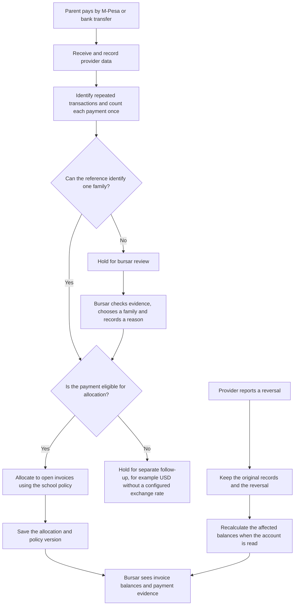

# Payment journey

Reversals can arrive before or after the original payment. Only eligible reference-related holds can be resolved by choosing a family; currency mismatches and conflicting records require separate follow-up. A later policy change does not rewrite an existing allocation: the saved plan retains the policy version used when it was made. The server calculates the effect of reversals when reading balances; the system does not save a separate correction ledger.
